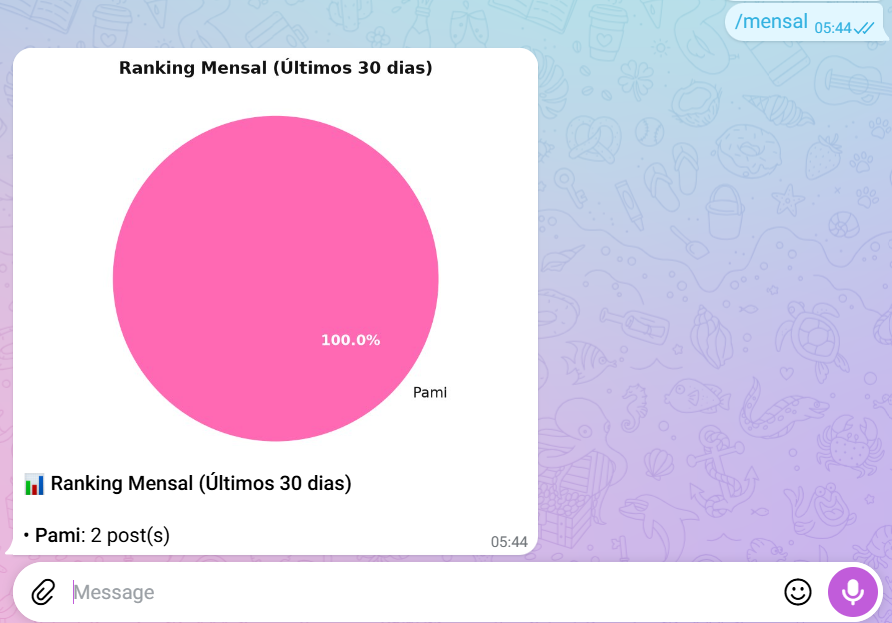

# 📊 Bot de Controle de Postagens e Produtividade (@portalblackpink)

Bot desenvolvido em **Python** e **SQLite** para automatizar o registro de postagens e o acompanhamento de metas de uma equipe de 12 administradores no Telegram, substituindo planilhas manuais por captura automática de links e geração de relatórios visuais.

## ✨ Funcionalidades

- **Registro Automático por Compartilhamento:** Detecta links do X/Twitter compartilhados diretamente no grupo, limpa parâmetros de rastreamento (`?s=...`) e grava o autor, o link e a data/hora em banco de dados relacional.
- **Proteção contra Duplicidade:** Consulta o banco SQL antes de inserir para impedir que o mesmo link seja contabilizado mais de uma vez.
- **Operações CRUD Completas em SQL:**
  - `Create`: Inserção automática de postagens e cadastro de perfis (`INSERT INTO`).
  - `Read`: Agregação de produtividade por período (`SELECT`, `COUNT`, `GROUP BY`, `ORDER BY`).
  - `Update`: Comando `/nome` para vincular o nome oficial do administrador ao seu histórico (`UPDATE`).
  - `Delete`: Comando `/desfazer` para remover o último registro enviado por engano (`DELETE`).
- **Relatórios e Visualização de Dados:**
  - `/relatorio` (ou `/semanal`): Ranking dos últimos 7 dias com verificação de meta semanal.
  - `/mensal` e `/anual`: Rankings de 30 e 365 dias acompanhados de **gráfico de pizza** gerado dinamicamente com `Matplotlib`.

## 📸 Demonstração



## 🛠️ Tecnologias Utilizadas

- **Python 3.14**
- **SQLite3** (Banco de dados relacional embutido)
- **pyTelegramBotAPI** (Integração com a API de Bots do Telegram)
- **Matplotlib** (Geração dinâmica de gráficos)
- **python-dotenv** (Gerenciamento seguro de credenciais)

## 🚀 Como Executar Localmente

1. **Clone este repositório:**
   ```bash
   git clone [https://github.com/panmella/bot-controle-postagens.git](https://github.com/panmella/bot-controle-postagens.git)
   cd bot-controle-postagens
   ```

2. **Instale as dependências:**
   ```bash
   pip install -r requirements.txt
   ```

3. **Configure as variáveis de ambiente:**
   Crie um arquivo `.env` na raiz do projeto (baseado no `.env.example`) com o token gerado pelo `@BotFather`:
   ```env
   TELEGRAM_TOKEN=seu_token_do_botfather_aqui
   ```

4. **Execute o bot:**
   ```bash
   py bot.py
   ```